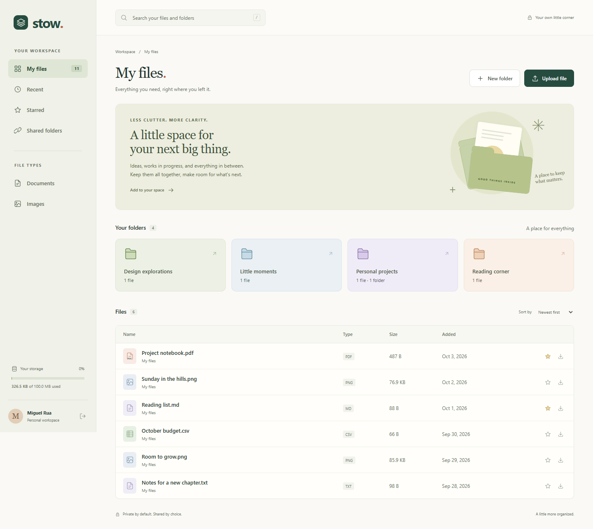
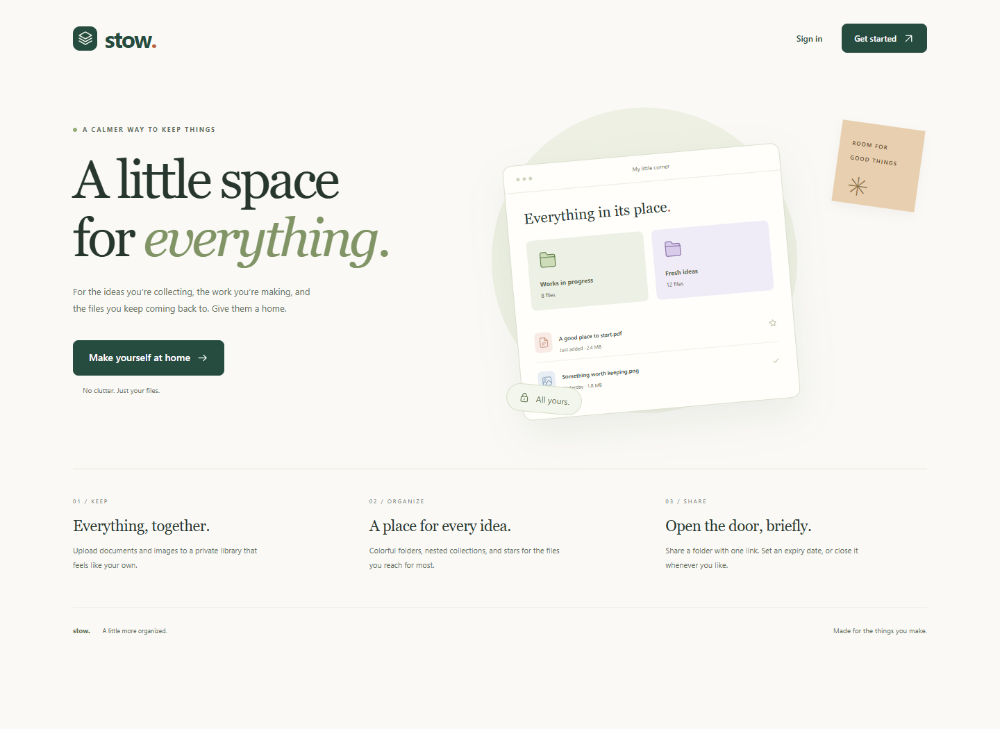
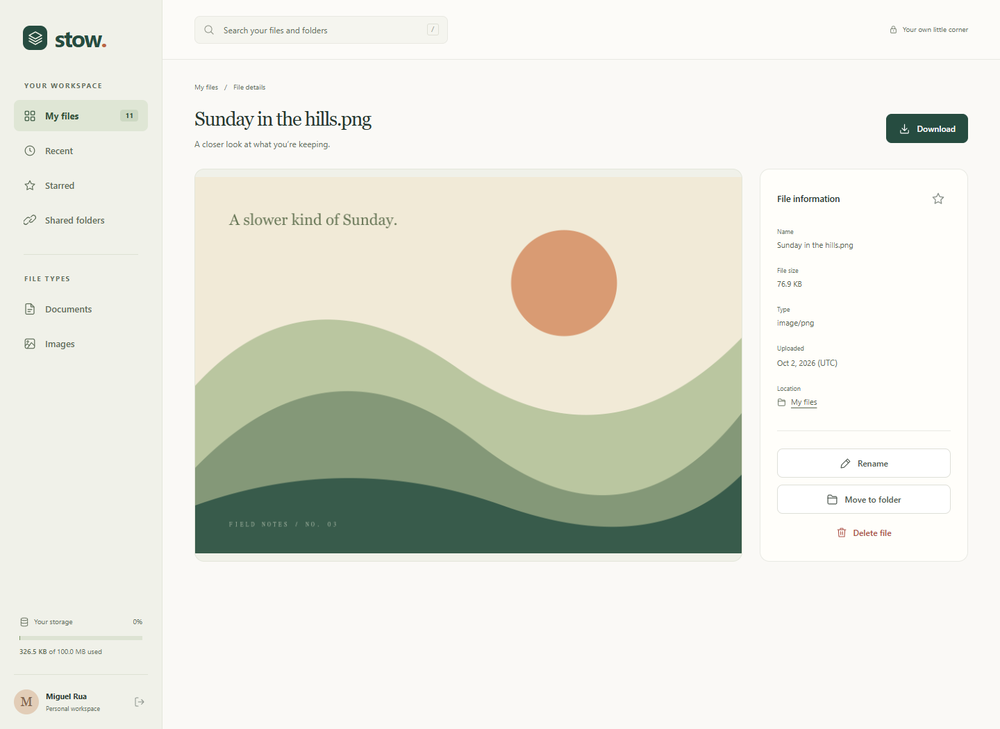
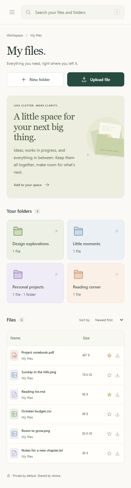

# Stow · File Uploader

[](https://github.com/MiguelRcol/file-uploader/actions/workflows/ci.yml)


**A personal file library with a little more room to breathe.**

Stow brings private uploads, nested folders, and expiring share links into a calm, responsive workspace. It is a full-stack implementation of [The Odin Project’s File Uploader assignment](https://www.theodinproject.com/lessons/nodejs-file-uploader), including the folder-sharing extra credit.



## Features

- Create an account and sign in with Passport.js. Sessions survive server restarts through the Prisma session store.
- Upload PDF, PNG, JPG, WebP, TXT, Markdown, and CSV files with drag and drop, upload progress, and server-side validation.
- Create nested folders, rename them, choose a color, and delete their contents recursively.
- View file information, preview images, download original bytes, rename files, and move them between folders.
- Search by name, sort your library, browse recent files, and star favorites.
- Share a folder and its descendants with a public, view-only link lasting 1–30 days. Revoke access whenever you like.
- Keep files on the local filesystem or configure authenticated Cloudinary storage. Every download passes through the application’s access checks.
- Use the same workspace on desktop and mobile, with keyboard navigation, labeled controls, native dialogs, and reduced-motion support.

## Run locally

Install **Node.js 22.12 or later** (Node 24 is used in CI), then:

```bash
git clone https://github.com/MiguelRcol/file-uploader.git
cd file-uploader
npm ci
npm run setup
npm run dev
```

Open **http://localhost:3000** and create an account. The setup command creates `.env` with a random session secret, generates the Prisma client, and applies the committed database migrations. SQLite and local storage work without a cloud account.

On Windows, double-click **Start Stow.cmd** after installation. The launcher opens your browser and runs the application in a terminal; keep that terminal open while using Stow.

### Explore the demo workspace

```bash
npm run demo
```

The demo command creates a separate account with sample folders, documents, and original abstract illustrations. Its randomly generated password is saved in the ignored `data/demo-access.txt` file. This command is disabled in production and is safe to run again without duplicating data. Your own account is unaffected.

<details>
<summary>More screenshots</summary>






</details>

## Configuration

Copy the variable names from [`.env.example`](.env.example). Do not commit `.env`, the database, or uploaded files.

| Variable           | Purpose                                   | Default                 |
| ------------------ | ----------------------------------------- | ----------------------- |
| `APP_URL`          | Canonical origin for share links          | `http://localhost:3000` |
| `PORT`             | HTTP server port                          | `3000`                  |
| `DATABASE_URL`     | SQLite path, relative to the project root | `file:./data/stow.db`   |
| `SESSION_SECRET`   | Random secret of at least 32 characters   | Generated by setup      |
| `STORAGE_PROVIDER` | `local` or `cloudinary`                   | `local`                 |
| `UPLOAD_DIR`       | Private local file directory              | `./uploads`             |
| `MAX_FILE_SIZE_MB` | Per-file upload limit, 1–25 MB            | `10`                    |
| `USER_QUOTA_MB`    | Per-account quota, 1–1024 MB              | `100`                   |
| `TRUST_PROXY`      | Trust exactly one reverse proxy           | `false`                 |

### Cloudinary

Set `STORAGE_PROVIDER=cloudinary` and supply `CLOUDINARY_CLOUD_NAME`, `CLOUDINARY_API_KEY`, and `CLOUDINARY_API_SECRET`. Restart the server after changing configuration.

Uploads use Cloudinary’s `raw` resource type and `authenticated` delivery so original bytes are preserved and unsigned URLs cannot expose private files. The database stores the storage key and returned URL. The server signs and streams downloads only after verifying ownership or an active share link; signed delivery URLs are never sent to the browser.

Existing local files remain readable after changing providers. Keep the original upload directory available until those files are removed. Changing the provider affects new uploads; it does not migrate existing files. Cloudinary support is covered with mocked adapter tests; live cloud verification requires an account and credentials.

## Checks

```bash
npm run check
npm run format:check
npm test
npm run build
npm audit
npx playwright install chromium
npm run test:ui
```

Integration tests run against isolated SQLite databases and temporary upload directories. They cover authentication, stored sessions, CSRF, user isolation, signature validation, quota, downloads, folder CRUD, file operations, public sharing, expiry, revocation, and deletion cleanup. Browser tests run the complete account → folder → upload → download → share → revoke flow on desktop and mobile, with automated accessibility checks.

If using an existing Chromium installation, set `PLAYWRIGHT_CHROMIUM_EXECUTABLE_PATH` to its executable path. To refresh the screenshots, run the local server, create the demo account, then run `node scripts/screenshots.mjs`.

## How it is built

**Express 5 · TypeScript · EJS · Prisma 7 · SQLite · Passport.js · Multer · Cloudinary**

The server renders pages; a small browser script handles dialogs, uploads, stars, and clipboard actions. A storage interface separates file persistence from ownership and quota logic. A persistent deletion queue retries blob cleanup after metadata is removed, including after server restarts.

- [Architecture and data model](docs/architecture.md)
- [Deployment and backup guide](docs/deployment.md)
- [Portfolio project summary](docs/portfolio.md)

## Scope

Stow is intended for personal use and a single server instance. SQLite and the session database require persistent disk even when files live in Cloudinary. Expiring links share the current contents of a folder, including files added later. Revocation prevents new requests; it cannot recall files someone already downloaded.

The app has no password-reset email flow, antivirus scanning, or account-recovery service. Text validation checks UTF-8; binary validation checks the file signature and extension. Use it with files and people you trust, and back up the database and storage together.

## Author and license

Built by [MiguelRcol](https://github.com/MiguelRcol). Licensed under [MIT](LICENSE).
