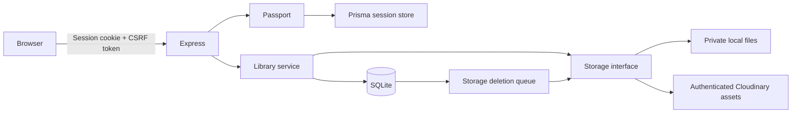
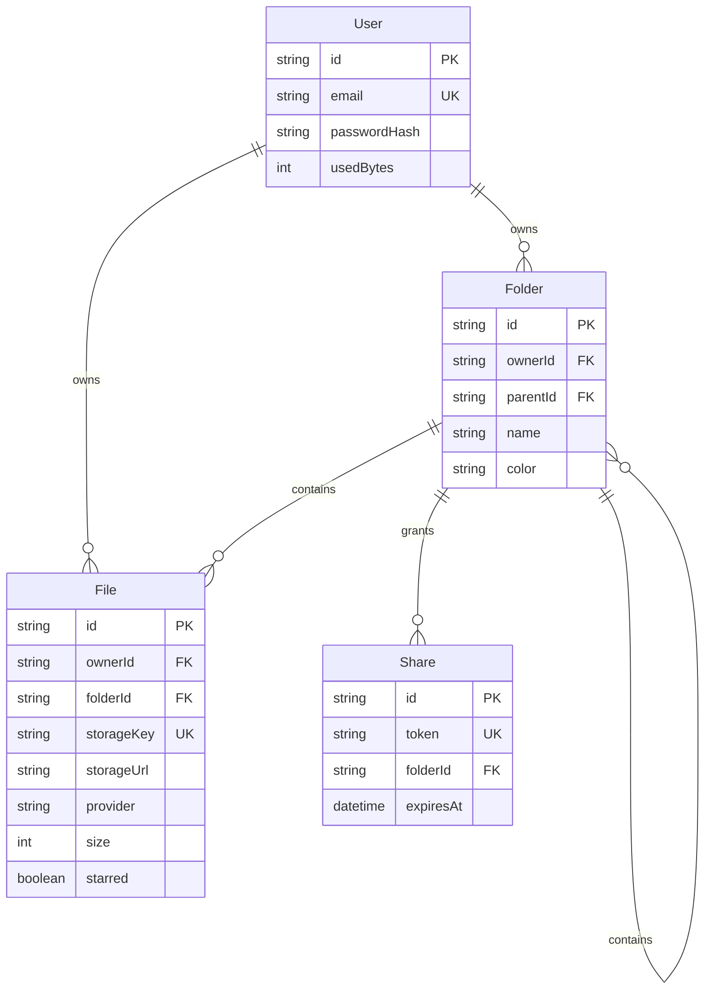

# Architecture

Stow uses server-rendered pages and a small amount of browser JavaScript. Most mutations work through conventional POST forms, while uploads and starring use asynchronous requests. Prisma manages metadata, users, sessions, share links, quota accounting, and pending storage deletions.

## Source layout

| Path                      | Responsibility                                                   |
| ------------------------- | ---------------------------------------------------------------- |
| `src/app.ts`              | Middleware, sessions, routing, error handling, and lifecycle     |
| `src/routes/auth.ts`      | Registration, Passport login, logout, and authentication limits  |
| `src/routes/library.ts`   | Private library routes and public share routes                   |
| `src/services/library.ts` | Ownership, quota transactions, recursive deletion, share scope   |
| `src/storage.ts`          | Local and Cloudinary adapters and deletion worker                |
| `src/lib/validation.ts`   | Form schemas, extension allowlist, file signatures, UTF-8 checks |
| `prisma/`                 | Schema and versioned migrations                                  |
| `views/`                  | EJS pages and shared partials                                    |
| `public/`                 | Styles, browser interactions, SVG icon sprite, favicon           |
| `tests/`                  | Database-backed integration tests and Playwright browser tests   |

## Data model

The session model follows the Prisma session store contract (`id`, `sid`, `data`, `expiresAt`). A separate `StorageDeletion` table holds durable cleanup jobs.

## Upload lifecycle

1. Require an authenticated session and check rate limits. Requests with a CSRF header are checked before the multipart parser; ordinary multipart forms are checked immediately after parsing.
2. Multer reads one bounded file into memory. The server validates its name, extension, non-empty size, and contents. Binary signatures must match the extension; text must decode as UTF-8 without binary control characters.
3. Check the destination belongs to the account and verify the account’s remaining storage.
4. Store bytes under a random identifier. Original filenames are metadata, never filesystem paths.
5. In a database transaction, recheck the folder, atomically reserve quota, and insert the file metadata. If this fails, enqueue the stored object for cleanup.

Uploads are bounded to 25 MB maximum per request, with a default of 10 MB. Each account defaults to 100 MB. Quota reservation uses a conditional update inside the metadata transaction so competing uploads cannot exceed the limit.

## Access and sharing

Private file and folder queries always include the authenticated owner’s ID. Downloads and image previews go through these checks; the upload directory is never served as a static directory.

Share links use random UUID tokens and have a server-checked expiry date. Public routes resolve the shared folder’s descendant tree and allow reads only within that tree. They offer no mutation routes. Every public download revalidates the link. Shared responses disable caching, indexing, and referrer propagation.

Cloudinary assets use authenticated delivery. Signed storage URLs stay on the server; the application streams bytes to the client so a user never receives a reusable storage URL that could bypass future revocation.

## Deletion and failure handling

Deleting a file or folder transactionally removes metadata, returns quota, and inserts blob-deletion jobs. Cascading foreign keys remove descendant metadata and share links. The worker drains up to 50 jobs at a time, deleting each job only when storage deletion succeeds. Failures are retried every minute and remain in the database across restarts.

## Security choices

- Passwords use Node’s asynchronous scrypt with random per-password salts and constant-time verification.
- Passport regenerates sessions when signing in; logout destroys the persisted session.
- Cookies are HttpOnly, SameSite=Lax, and Secure in production.
- All state-changing routes use session-bound CSRF tokens. Login and upload routes have rate limits.
- EJS escapes user content. Helmet sets a restrictive content security policy and security headers.
- Production refuses an HTTP origin or the placeholder session secret.

This implementation targets one application instance. Rate limiting is process-local. A deployment with multiple instances would need a shared rate-limit store, a different database adapter, and coordinated deletion workers.
